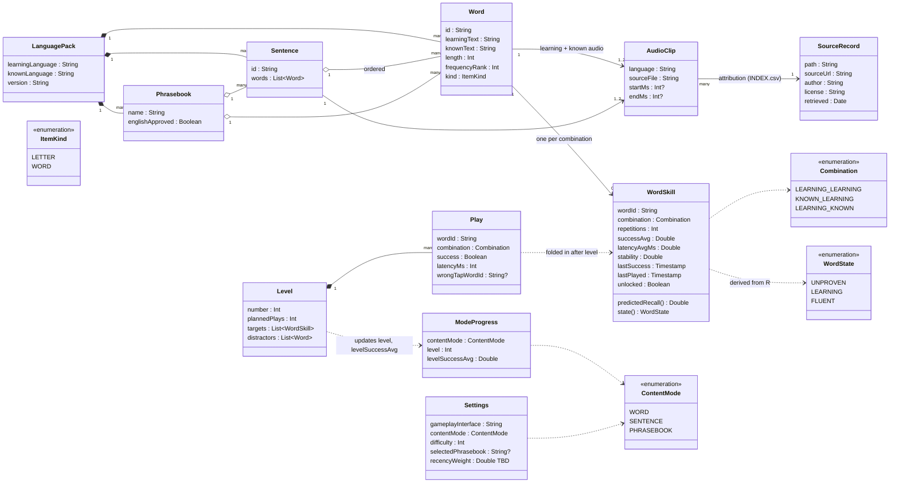

# Data model (draft)

Derived from [requirements.md](requirements.md) as of 2026-11-12. Conceptual, not an implementation: names and types will change. `TBD` fields are still under discussion.

Three groups:
- **Language pack**: read-only data shipped in the language file.
- **User state**: running values saved on the device.
- **Level session**: in memory only; folded into user state on the between-levels screen, then discarded.

Notes:
- **WordSkill** is the core of the spaced repetition: one row per word and combination, with running values only (no long-term log). `predictedRecall()` and `state()` are computed, not stored.
- **stability** is a single value for now. If we adopt FSRS-7's two-curve idea, it becomes a fast (within-session) and a slow (across-days) stability.
- **Letters** are modelled as `Word` with `kind = LETTER`, so they share WordSkill and selection.
- **Sentence score** (hits / (words + wrong taps)) is computed from the level's plays; whether sentences get their own skill rows is TBD.
- **ModeProgress** is per content mode, matching "level number saved per game mode". If gameplay interfaces multiply, the key becomes (interface, content mode).
