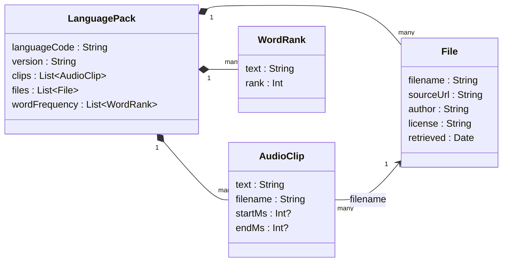
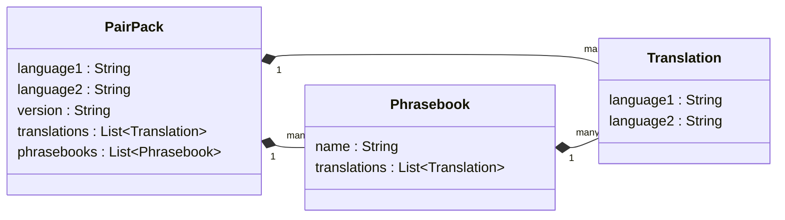
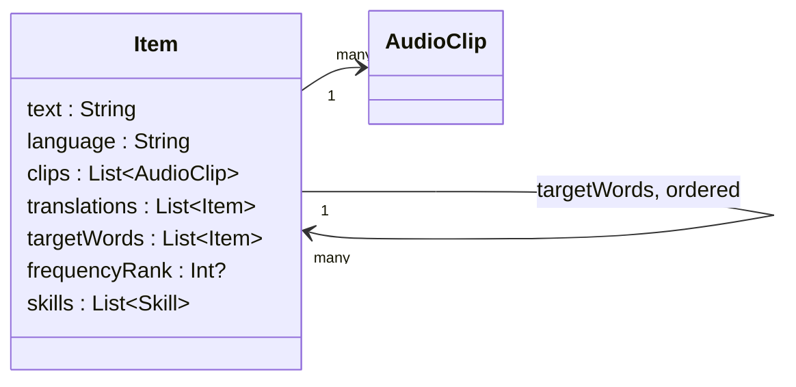
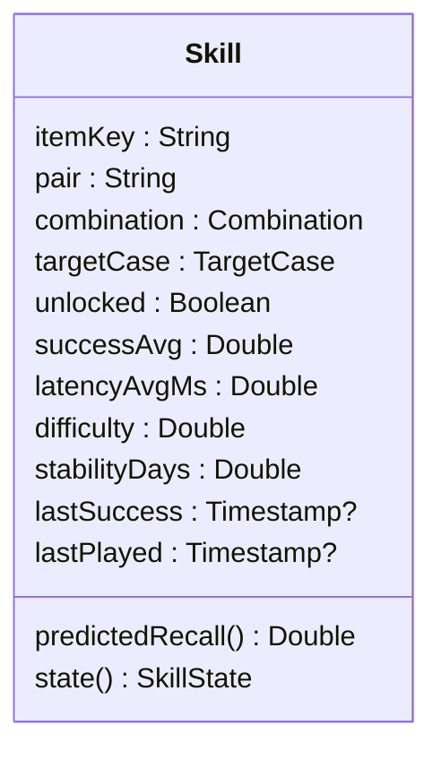
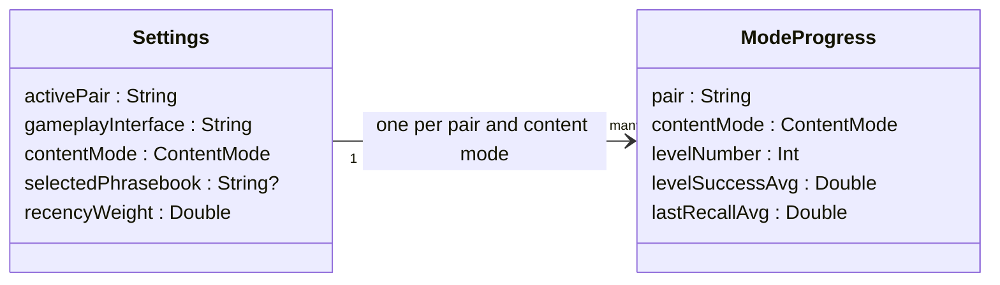
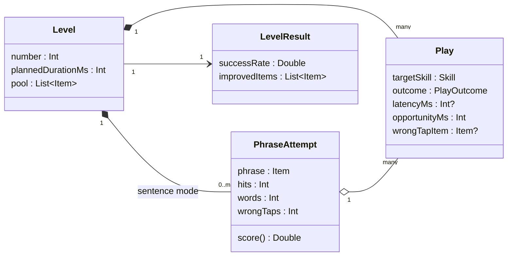

# Data model (draft)

Derived from [requirements.md](requirements.md). Conceptual, not an implementation: names and types will change. Selection math: [selection.md](selection.md).

Three layers, modeled separately:
1. **Files**: what ships (language packs, pair packs). Plain text plus audio. No numeric ids: **text is the key**.
2. **In memory**: object graph built when the files load. Objects point at each other by reference, not by key.
3. **Saved user data**: keyed by text, so progress survives pack updates and user edits.

Diagrams are kept small; a diagram may name a class drawn in another one.

## Items
- **Translations** are the learning unit: a pair of texts, one per language. A **word** is a translation with one word on the target side; a **phrase** is a longer translation.
- **Targets** (what the user taps) are the words of the target text, parsed on spaces. The prompt is always the whole text/clip and is never split. Some short phrases carry grammar (gender, tense), so one side may look like a phrase while the other is one word; the target side is split anyway.
- **Letters** are not tracked as items. They are derived from word text and used only to pick new words that share letters with words already learning or fluent.
- **Phrasebook** = a named selection of translations. Studying one means first learning the words in its phrases, then the phrases once all their words are learning or fluent. A word in a phrase that has no translation of its own doesn't block the phrase; when such a word is a target, its distractors come from more fluent words.
- **Duplicate text** (homographs): ignored for now; when a text matches more than one translation, pick one at random. Proper handling is in open items.

## 1. Files

### 1a. Language pack (one per language)

- The pack also contains the audio files that `File` describes.
- `text` need not be unique: several clips may share a text (different speakers, accents, or a word cut from several phrases).
- `AudioClip.filename` links a clip to its file and attribution (no numeric `fileId`).

### 1b. Pair pack (one per language pair; plain JSON or XML)

- `Translation.language1` / `language2` hold texts, which match `AudioClip.text` in each language pack. No ids needed.
- Phrasebook translations are stored inline; the loader merges them with the pack-level list by text.

## 2. In memory (built at load)

- The loader builds one `Item` per distinct text (by match key, below), attaches its clips, links translations, and splits multi-word texts into `targetWords`.
- `targetWords` and `letterCount` are derived, never stored.
- Items with no clip in the prompt language are not playable (requirements).

**Match key** (used to match text across files and to key saved data): Unicode NFC, case-folded, punctuation stripped, accents kept. Display uses the original text, or its ALL CAPS form (Greek caps drop accents; ς becomes Σ). Note: case folding also maps final ς to σ, which is fine for matching since both sides are folded.

## 3. Saved user data (on device)

### 3a. Skill
One row per learning-language item, language pair, combination and target case. Running values only; `predictedRecall()` and `state()` are computed (see [selection.md](selection.md)).

- `itemKey` = match key of the learning-language text; `pair` e.g. `el-en`. Word vs phrase is derived from the text (one word or several).
- Repetitions are not stored (see selection.md §3).

| Enum | Values |
|---|---|
| Combination | LEARNING_LEARNING, KNOWN_LEARNING, LEARNING_KNOWN |
| TargetCase | AS_WRITTEN, ALL_CAPS (learning-language targets only; known-language targets use AS_WRITTEN) |
| SkillState | UNPROVEN, LEARNING, FLUENT |
| ContentMode | WORD, SENTENCE, PHRASEBOOK |
| PlayOutcome | HIT, WRONG_TAP, TIMEOUT |

### 3b. Progress and settings

- The separate `difficulty` value is proposed to go away: level number sets the pool size, latency sets the speed (selection.md §8–9).
- If gameplay interfaces multiply, the ModeProgress key gains the interface.

## 4. Level session (memory only)
Folded into Skill and ModeProgress during the between-levels screen, then discarded. In memory these hold references to `Item` and `Skill`, not keys.

- `opportunityMs` = time from prompt until the target leaves the screen.
