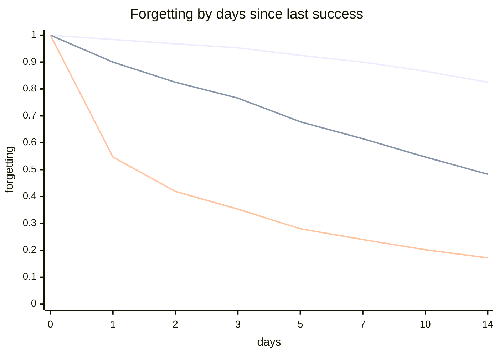
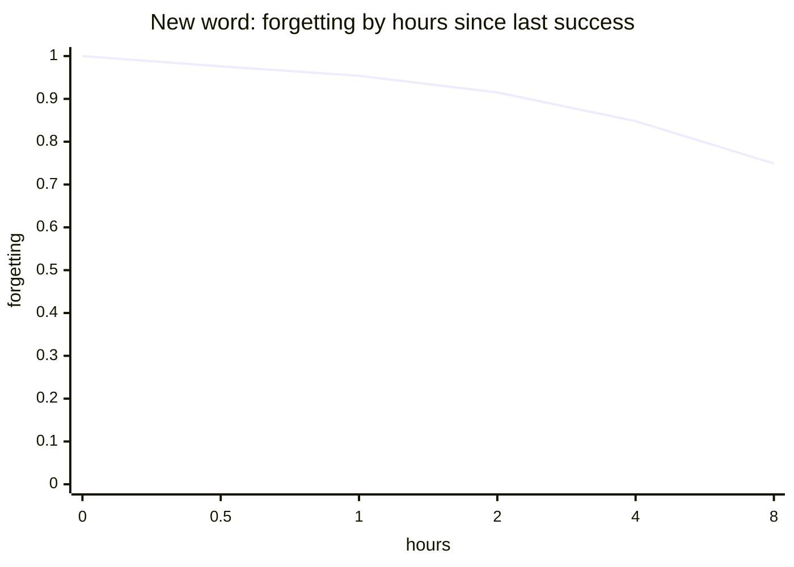
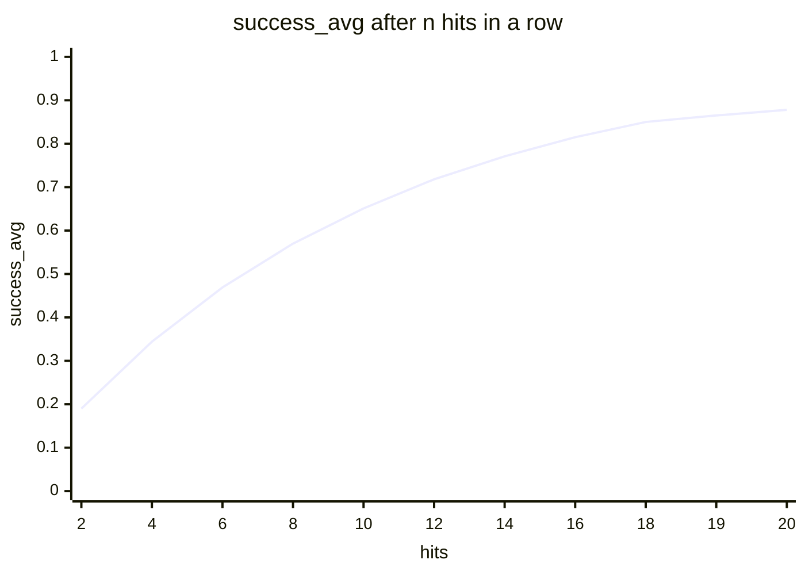

# Selection equations (draft, round 2)

How the selection engine turns a level's plays into saved values, and saved values into the next level. Sections run in data-flow order: play log → per-play values → saved running values → recall → level building. Every variable is defined before it is used. All constants are starting guesses to tune by playing. **(proposed)** marks a choice Claude made that you have not reviewed yet; the rest follows your comments.

A **skill** is one item (word or phrase) × language pair × combination (see [data-model.md](data-model.md)). `now` is the current time. Durations are in days unless they end in `_ms`.

Compared schemes (references in `docs/open-items.md`): FSRS, half-life regression (HLR, Duolingo), SM-2, Leitner.  Algorithms aimed to accommodate either rapid learning long session game play or short daily review play.  It will be up to the player to pick a play time necessary to maintain their desired fluency.  Decay rate will automatically cause daily review play to cover different words as long as the player succeeds at review.  Level demotion will allow narrowing the learning pool when player stops succeeding, with level indicating to the user the learning progress.

## 1. Level play log (memory only)
One record per prompt. A prompt always ends in a hit or a timeout; wrong taps can come before either.

| Field | Meaning |
|---|---|
| `target_skill` | the skill whose prompt played |
| `outcome` | `hit` or `timeout` |
| `taps` | taps on words, including the final hit (0 on a timeout with no wrong taps) |
| `latency_ms` | prompt to the hit; hits only |
| `opportunity_ms` | prompt until the target left the screen (or would have) |
| `wrong_tap_words` | list of distractors tapped by mistake (may be empty) |

Each tapped distractor also gets its own `wrong_tap` play for its skill, in the same combination (requirements: a failure for both words). Taps on empty space are not plays; they only slow the fall (§8).

**Debug play log (prototype only):** each level's records are also written to a JSON-lines file on the device, next to the progress file, for later analysis. Only the 10 newest files are kept, so it can't fill the disk. In the long run the log stays in memory only.

## 2. Per-play values (derived from the log)
```
play_score        = 1 / taps                if hit   (1 for a clean hit, 0.5 after one wrong tap, ...)
                    0                       if timeout
                    0                       for a tapped distractor's wrong_tap play

latency_sample_ms = latency_ms              if hit
                    1.1 × opportunity_ms    if timeout
                    none                    for a tapped distractor's wrong_tap play
```
- Every prompt yields a latency sample for its target, since it always ends in a hit or a timeout.
- A hit is a **success** when `play_score` = 1 and a **failure** otherwise (this picks the weight in §3 and the stability rule in §5).
- A timeout's latency sample is longer than the time the word was on screen, so the word falls more slowly next time.

## 3. Saved running values (per skill)
Updated between levels, one play at a time in play order. The weight `w` is how much the newest play counts against all older plays combined. Success counts less than failure, so fluency takes longer to reach:
```
w = success_weight (0.1)    on a success (play_score = 1)
    failure_weight (0.25)   otherwise
```

| Value | Update per play | Start |
|---|---|---|
| `success_avg` | `(1 − w) × success_avg + w × play_score` | 0 |
| `latency_avg_ms` | `0.8 × latency_avg_ms + 0.2 × latency_sample_ms` (single weight); skipped when there is no sample | 10,000 |
| `difficulty` | `(1 − w) × difficulty + w × (1 − play_score)` | `initial_difficulty` (§4) |
| `stability_days` | §5 | 0.1 |
| `last_played` | `now` | none |
| `last_success` | `now` if hit | none |

- **Repetitions removed**, as you suggested: more practice shows up as higher `success_avg`, lower `latency_avg_ms` and higher `stability_days`, and nothing downstream needs the raw count.
- From 0, 19 clean hits in a row reach the fluent threshold (graph C). One failure at 0.85 drops `success_avg` to 0.64; 9 clean hits bring it back, so no word is stuck penalized.
- **Recency weight and long breaks:** the weight is per play, not per hour. A long break doesn't make every word "non-recent"; time away acts only through the forgetting curve (§6). A marathon player simply gets more plays, each weighted the same. Whether `recency_weight` auto-adapts per user stays open.
- Compare: HLR uses counts of correct and wrong answers; this is the same idea with recent plays counting more. FSRS has no running average; it stores difficulty and stability only.

## 4. Initial word difficulty (0 easy to 1 hard)
Set once, when a skill first enters play:
```
length_score       = min(letter_count / long_word_letters, 1)
rarity_score       = frequency_rank / vocabulary_size        (0 = most common word)
initial_difficulty = clamp(length_weight × length_score + rarity_weight × rarity_score, 0.1, 1)
```
Constants: `long_word_letters` = 10, `length_weight` = 0.7, `rarity_weight` = 0.3.

After that, `difficulty` is the recency-weighted failure rate seeded with `initial_difficulty` (§3).
- Rarity barely matters to a true beginner, but it helps learners who have studied before, and it puts word frequency into new-word picking for free (§8).
- **Speed is separate**: difficulty is used only for stability (§5) and for picking new words (§8). Fall speed comes from latency alone (§8). This keeps gameplay tuning and word selection apart, as you asked.
- Compare: FSRS sets initial difficulty from the first rating, then moves it with each rating. We seed from length and rarity, then move it with play outcomes.

## 5. Stability (days)
`recall_before` = predicted recall (§6) just before the play.
```
clean hit (play_score = 1):     stability_days = stability_days × (1 + growth_rate × (1 − difficulty) × (1 − recall_before))
hit after wrong taps, wrong_tap: stability_days = max(min_stability, stability_days × wrong_tap_factor)
timeout:                         stability_days = max(min_stability, stability_days × timeout_factor)
```
Constants: `growth_rate` = 3, `min_stability` = 0.05 day, `wrong_tap_factor` = 0.5, `timeout_factor` = 0.8.
- **TBD:** whether a timeout should shrink stability less than a wrong tap (both are failures for recall). Using 0.8 vs 0.5 for now.
- Growth is largest when recall was hard (low `recall_before`) and the word is easy (low `difficulty`). In massed practice recall is near 1, so ten hits in a row add little stability; spacing does the work.
- Failures shrink stability but never reset it, so a word known before relearns faster (no "ease hell").
- Compare: simplified FSRS stability update (FSRS also grows with 1 − R and shrinks with D, and uses a separate post-lapse formula). FSRS-7 splits stability into fast and slow; we keep one value.
- **No circular dependency:** each update reads `recall_before` from the values before the play, then writes the new stability; the next play reads that. It is a recurrence driven by plays, not a loop. It stays bounded: as stability grows, recall between plays stays high, so the growth term `(1 − recall_before)` shrinks.

## 6. Predicted recall (0 to 1)
```
days_since_success = now − last_success
forgetting         = (1 + (19/81) × days_since_success / stability_days) ^ (−0.5)
predicted_recall   = success_avg × forgetting          (0 if no success yet)
```
`forgetting` is the FSRS-4.5 curve: it reaches 0.9 when `days_since_success` = `stability_days`.

## 7. Skill states
```
fluent:    predicted_recall ≥ fluent_threshold   (0.85)
unproven:  no success yet
learning:  everything else
```
No recall threshold separates unproven from learning: a forgotten word with low recall is "learning", and ranking (§8) handles it. "Fluent" is a display label only (between-levels message); no rule depends on it. The remaining yes/no rules:
- Maximum one new (unproven) word per pool;
- the next combination unlocks after the previous one's first success;
- a phrase is eligible once each of its words has a success (words with no translation of their own don't count).

## 8. Building a level
Your simplification: the level number is the pool size, targets are drawn at random from the pool, and a level lasts about 5 minutes.

**Pool**
```
word_recall = lowest predicted_recall among the word's unlocked skills (combination × case)
pool_size   = level_number
pool        = the pool_size played words with the highest word_recall (fluent included)
              + 1 new word, if fewer than pool_size words have been played
```
- No fluency cutoff: fluent words stay in the pool and are simply picked less often (target weights below). The level then roughly equals the number of words in play, and a new word joins only after a level up.
- At most 1 unproven word in the pool. New words are picked by `new_word_score = (1 − initial_difficulty) + 0.2 × in_selected_phrasebook + 0.2 × letter_overlap` (letter_overlap = share of the word's letters already in played words). Short, common, phrasebook words with familiar letters come first.
- After a break, many words decay at once. The session-start level (§9) lowers the level up front, so the pool narrows to the best-known words.

**Targets**
1. Pick a pool word at random (uniform). Each draw is independent, so the same word may come twice in a row.
	1. If a phrase is selected, the words of the phrase will be the targets selected in that order.  The whole phrase will be finished even if this exceeds planned_time_ms.
2. Pick its skill (combination × case) with weight `(1 − predicted_recall) + 0.05` over unlocked skills, so the weakest is played most.
3. Add that skill's `latency_avg_ms` to `planned_time_ms`.
4. Repeat until `planned_time_ms` reaches `level_duration_ms`, which runs linearly from 100 s at level 1 to 300 s at level 5 (`100 s + 50 s × (level_number − 1)`), then stays at 300 s.
5. The new word, if any, gets at least `new_word_min_plays` = 5 targets: if the draw gave it fewer, replace randomly chosen other targets with it.

Step 1 picks words uniformly, but step 2's weights are per skill. Taken together, a word's chance follows its skills' weights: a fluent word (R 0.95, weight 0.10) still comes up sometimes, a new word (R 0, weight 1.05) about 10 times as often. *(Implementation: draw over all (word, skill) pairs in the pool with these weights.)* Example: pool of 10, 9 learning words at R ≈ 0.5 plus 1 new word: the new word gets about 18% of picks; with 9 fluent words, about 55%.

Check, level 1: pool = 1 new word, starting latency 10 s, 100 s budget: 10 targets, "one word ten times". Fall time starts at 20 s.

**Letter case** (for learning-language target text): each target is shown either as written (lowercase words, sentence case for phrases) or in ALL CAPS. Case is part of the skill, so both forms are tracked separately and both are unlocked from the start; level 1 shows one short word in both forms close together.

> Revisit this rule when adding additional languages in the future where other capitalization schemes may be appropriate.

**Max level** = the number of playable items in the language pack (not the pool size). At that level the label shows "Max".

**Fall speed** (from latency only)
```
fall_time_ms = clamp(latency_avg_ms / target_travel_share, 3,000, 60,000)
```
`target_travel_share` = 0.5: the average tap lands halfway down the screen. Distractors fall at the same speed as the target they appear with. At most 4 words on screen at once (tune later, maybe by level and screen size). Tracking latency spread to aim for exactly 90% success is deferred; halfway should do for now.
- **Empty tap:** a tap that hits no word makes every word on screen fall 5% slower for the rest of that prompt (fall time × 1/0.95 per tap, up to the 60,000 ms limit). It changes no history; slow hits and timeouts already move latency.
- **Entry:** a target and its distractors start falling one at a time, in random order, each at a random horizontal position that keeps the whole word on screen. The prompt audio plays when the group starts, so its timing doesn't reveal which word is the target; `latency_ms` and `opportunity_ms` count from when the target itself appears.

**Distractors** (words on screen that are not the target)
```
distractors = uniform random sample of (pool − target), size min(max_on_screen − 1, pool size − 1)
```
No recall rule and no weights, so every target gets the same number of distractors. Level 1 has none (the pool is one word). Earlier drafts gave weak targets only well-known distractors (min recall = target + (1 − target) × 0.5); dropped after play-testing because well-known targets got too few distractors.

**Phrases:** eligible only when every word in the phrase is learning or fluent in the phrase's combination.

## 9. Level result
```
Each target play counts as a hit only if it was a clean hit (`play_score` = 1). A target word is **established** if it had at least one success before this level started, and **new** otherwise.
```
rate_all         = clean hits / target plays
rate_established = clean hits / target plays, established targets only

level_number + 1   if rate_all > 0.9
unchanged          else if rate_established ≥ 0.8   (or there were no established targets)
level_number − 1   otherwise (minimum 1)
```
- Failures on new words mean "still learning", so they don't pull the level down: a level where you miss the new word but hit the rest stays (a "wave").
- Failures on established words mean the pool is too big: the level drops slowly, at most 1 per level.
- The level rises slowly: at most 1 per level.
- A fast drop after time away comes from the session-start rule below, not from this rule.
- The old running `level_success_avg` is dropped; no rule used it.
At the start of each session (app launch, or resume after 1 hour or more idle):
```
known_recall_avg    = average word_recall of the saved_level best-known words (fluent included)
session_start_level = max(1, round(saved_level × min(1, known_recall_avg now / known_recall_avg at the end of the last level)))
```
A daily player keeps their level; after a long break the level drops in proportion to what was forgotten, then climbs back by the +1 rule. `ModeProgress` stores the end-of-level average.
- The level number replaces the separate difficulty setting: level sets pool size, latency sets speed.
- Sentence mode: `phrase_score = hits / (words in phrase + wrong taps)`.

**Level label** (display only):
- red after the level went down, green after it went up, black when unchanged;
- while the level stays the same, a wave counter shows "wave 2", "wave 3", and so on. The wave plays no part in any calculation.

## 10. Graphs and session length
Mermaid line charts (render in GitHub and Obsidian). Series are listed in each caption, top line first.

**A. Forgetting curve over two weeks**, for stability 7 days, 1 day, 0.1 day (new word). y = `forgetting`.


**B. New word within one day** (stability 0.1 day = 2.4 hours).


**C. success_avg after consecutive clean hits** (success_weight 0.1, starting from 0). It takes 19 hits in a row to pass the 0.85 fluent threshold.


**Session length (15 minutes a day vs hours of play):**
- Forgetting depends on clock time since the last success, not on session count or length, so 3 levels a day and 40 levels a day use the same curves.
- Session length changes how many plays each word gets. A long session pushes `success_avg` up quickly (graph C) but adds little stability (§5), because recall stays near 1 during massed play. Stability grows when the player comes back after a gap and still hits.
- Established schedules (Anki, FSRS) aim to show an item again when recall drops to about 0.9: for a new word that is about 2.4 hours (graph B), then days. Our pool does something similar without due dates: as a word's recall rises its pick weight falls, and as recall decays the weight rises again.
- The round 1 "freshness" penalty (and its τ) is dropped: weighted random picks do the same job more simply. (A later no-back-to-back-repeat rule was also dropped after play-testing: with a two-word pool it made level 2 strictly alternate.)
