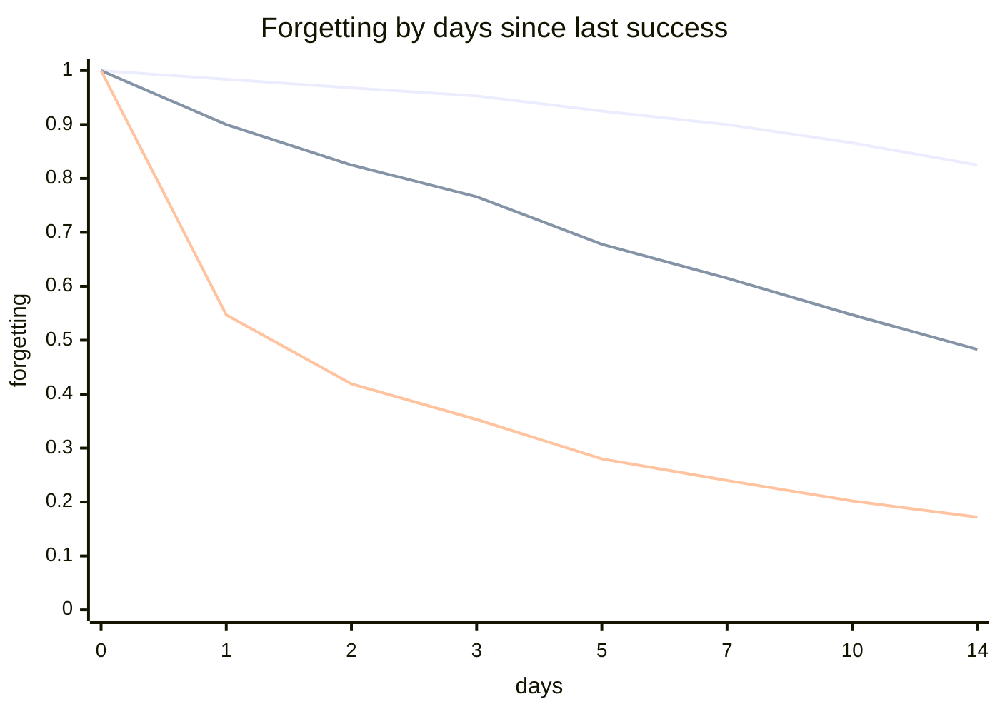
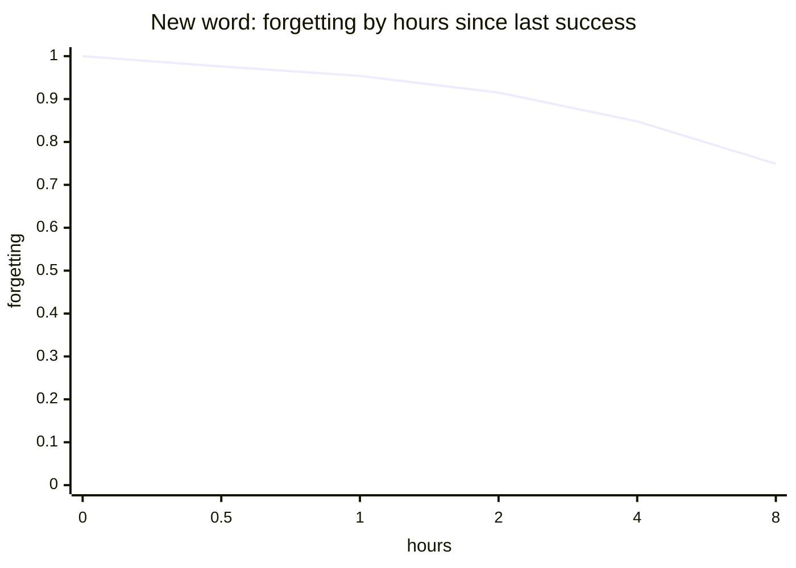
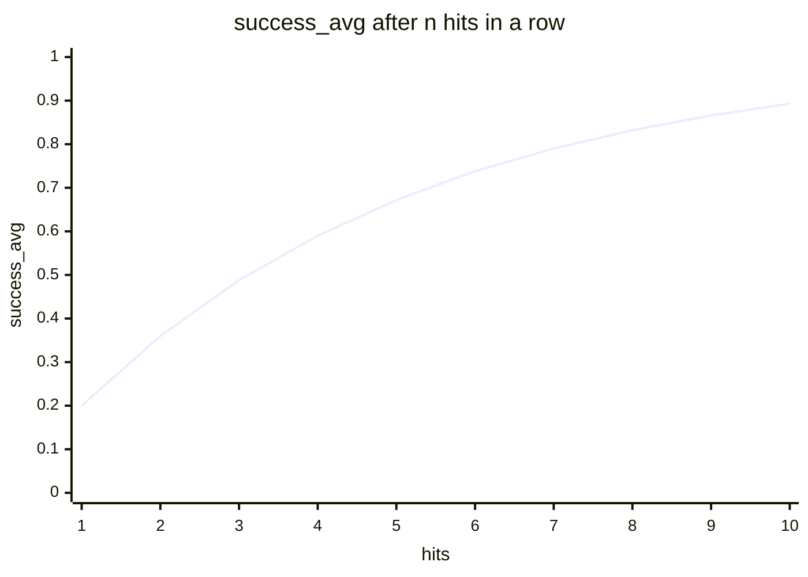

# Selection equations (draft, round 2)

How the selection engine turns a level's plays into saved values, and saved values into the next level. Sections run in data-flow order: play log → per-play values → saved running values → recall → level building. Every variable is defined before it is used. All constants are starting guesses to tune by playing. **(proposed)** marks a choice Claude made that you have not reviewed yet; the rest follows your comments.

A **skill** is one item (word or phrase) × language pair × combination (see [data-model.md](data-model.md)). `now` is the current time. Durations are in days unless they end in `_ms`.

Compared schemes (references in `docs/open-items.md`): FSRS, half-life regression (HLR, Duolingo), SM-2, Leitner.  Algorithms aimed to accommodate either rapid learning long session game play or short daily review play.  It will be up to the player to pick a play time necessary to maintain their desired fluency.  Decay rate will automatically cause daily review play to cover different words as long as the player succeeds at review.  Level demotion will allow narrowing the learning pool when player stops succeeding, with level indicating to the user the learning progress.

## 1. Level play log (memory only)
One record per play:

| Field | Meaning |
|---|---|
| `target_skill` | the skill whose prompt played |
| `outcome` | `hit`, `wrong_tap` or `timeout` |
| `latency_ms` | prompt to tap; hits only |
| `opportunity_ms` | prompt until the target left the screen (or would have) |
| `wrong_tap_word` | word tapped by mistake, if any |

A wrong tap also logs a `wrong_tap` play for the tapped word's skill, in the same combination (requirements: a failure for both words).

>we need to explore wrong_tap more.  There could be multiple wrong taps and then a hit or timeout.  play_score should be if hit 1/number of taps, and if miss 0?  latency_sample_ms will never be none, the target will later be hit or timeout.  wrong_tap_word can be a list of distractors tapped.

> In the long run we want this in memory only, in early drafts it may be useful to save these temporarily for retrospective analysis.

## 2. Per-play values (derived from the log)
```
play_score        = 1    if hit
                    0    if timeout or wrong_tap

latency_sample_ms = latency_ms              if hit
                    1.1 × opportunity_ms    if timeout
                    none                    if wrong_tap   (latency unchanged)
```
- A timeout is a failure for recall, like a wrong tap. The two differ in latency (below) and stability (§5): a timeout also slows the word down.
- A timeout's latency sample is longer than the time the word was on screen, so the word falls more slowly next time.

## 3. Saved running values (per skill)
Updated between levels, one play at a time in play order. `recency_weight` = 0.2: how much the newest play counts against all older plays combined.

| Value | Update per play | Start |
|---|---|---|
| `success_avg` | `(1 − recency_weight) × success_avg + recency_weight × play_score` | 0 |
| `latency_avg_ms` | same form with `latency_sample_ms`; skipped when there is no sample | 10,000 |
| `difficulty` | same form with `1 − play_score` | `initial_difficulty` (§4) |
| `stability_days` | §5 | 0.1 |
| `last_played` | `now` | none |
| `last_success` | `now` if hit | none |

- **Repetitions removed**, as you suggested: more practice shows up as higher `success_avg`, lower `latency_avg_ms` and higher `stability_days`, and nothing downstream needs the raw count.
- **Recency weight and long breaks:** the weight is per play, not per hour. A long break doesn't make every word "non-recent"; time away acts only through the forgetting curve (§6). A marathon player simply gets more plays, each weighted the same. Whether `recency_weight` auto-adapts per user stays open.
- Compare: HLR uses counts of correct and wrong answers; this is the same idea with recent plays counting more. FSRS has no running average; it stores difficulty and stability only.

## 4. Initial word difficulty (0 easy to 1 hard)
Set once, when a skill first enters play:
```
length_score       = min(letter_count / long_word_letters, 1)
rarity_score       = frequency_rank / vocabulary_size        (0 = most common word)
initial_difficulty = clamp(length_weight × length_score + rarity_weight × rarity_score, 0.1, 1)
```
Constants: `long_word_letters` = 10, `length_weight` = 0.7, `rarity_weight` = 0.3.

After that, `difficulty` is the recency-weighted failure rate seeded with `initial_difficulty` (§3).
- Rarity barely matters to a true beginner, but it helps learners who have studied before, and it puts word frequency into new-word picking for free (§8).
- **Speed is separate**: difficulty is used only for stability (§5) and for picking new words (§8). Fall speed comes from latency alone (§8). This keeps gameplay tuning and word selection apart, as you asked.
- Compare: FSRS sets initial difficulty from the first rating, then moves it with each rating. We seed from length and rarity, then move it with play outcomes.

## 5. Stability (days)
`recall_before` = predicted recall (§6) just before the play.
```
hit:        stability_days = stability_days × (1 + growth_rate × (1 − difficulty) × (1 − recall_before))
wrong_tap:  stability_days = max(min_stability, stability_days × wrong_tap_factor)
timeout:    stability_days = max(min_stability, stability_days × timeout_factor)
```
Constants: `growth_rate` = 3, `min_stability` = 0.05 day, `wrong_tap_factor` = 0.5, `timeout_factor` = 0.8.
- **TBD:** whether a timeout should shrink stability less than a wrong tap (both are failures for recall). Using 0.8 vs 0.5 for now.
- Growth is largest when recall was hard (low `recall_before`) and the word is easy (low `difficulty`). In massed practice recall is near 1, so ten hits in a row add little stability; spacing does the work.
- Failures shrink stability but never reset it, so a word known before relearns faster (no "ease hell").
- Compare: simplified FSRS stability update (FSRS also grows with 1 − R and shrinks with D, and uses a separate post-lapse formula). FSRS-7 splits stability into fast and slow; we keep one value.
> Do we have a problem that Stability and Predicted recall have a circular dependency, or does the calculation order prevent any feedback loops without user behavior adjusting them?

## 6. Predicted recall (0 to 1)
```
days_since_success = now − last_success
forgetting         = (1 + (19/81) × days_since_success / stability_days) ^ (−0.5)
predicted_recall   = success_avg × forgetting          (0 if no success yet)
```
`forgetting` is the FSRS-4.5 curve: it reaches 0.9 when `days_since_success` = `stability_days`.

Your questions:
- **Is this the fluency value used for categories?** Yes, one value. It decays over time, so fluent words come back for review, as in normal spaced repetition.
- **Previously known words relearning faster:** happens on its own. Their `stability_days` stays high (failures shrink it, never reset it), so after a few hits their recall holds up much longer than a new word's. No extra rule proposed.
- **Hard thresholds lumping decayed words together:** solved by ranking instead of bands (§8). Thresholds are now used only for yes/no rules (§7).
- Compare: FSRS retrievability uses the same curve; HLR uses `2^(−days/half_life)`; Leitner boxes are a coarse step version.

## 7. Skill states
```
fluent:    predicted_recall ≥ fluent_threshold   (0.85)
unproven:  no success yet
learning:  everything else
```
No recall threshold separates unproven from learning: a forgotten word with low recall is "learning", and ranking (§8) handles it. The remaining yes/no rules:
- pool cutoff (fluent words stay out of the pool, §8);
- one new (unproven) word per pool;
- the next combination unlocks after the previous one's first success;
- a phrase is eligible once each of its words has a success (words with no translation of their own don't count).

## 8. Building a level
Your simplification: the level number is the pool size, targets are drawn at random from the pool, and a level lasts about 5 minutes.

**Pool**
```
word_recall = lowest predicted_recall among the word's unlocked skills (combination × case)
pool_size   = level_number
pool        = the pool_size words with the highest word_recall below fluent_threshold
```
- At most 1 unproven word in the pool. New words are picked by `new_word_score = (1 − initial_difficulty) + 0.2 × in_selected_phrasebook + 0.2 × letter_overlap` (letter_overlap = share of the word's letters already in learning or fluent words). Short, common, phrasebook words with familiar letters come first.
- Fluent words stay out of the pool and serve only as distractors until their recall decays below `fluent_threshold`; then they fall back in on their own. If fewer non-fluent words exist than `pool_size`, the pool is simply smaller.
- After a break, many fluent words decay at once. The session-start level (§9) lowers the level up front, so the player doesn't first sit through one very hard level.

**Targets**
1. Pick a pool word at random (uniform), but not the previous target unless the pool has one word.
2. Pick its skill (combination × case) with weight `(1 − predicted_recall) + 0.05` over unlocked skills, so the weakest is played most.
3. Add that skill's `latency_avg_ms` to `planned_time_ms`.
4. Repeat until `planned_time_ms` reaches `level_duration_ms`, which runs linearly from 100 s at level 1 to 300 s at level 5 (`100 s + 50 s × (level_number − 1)`), then stays at 300 s.

Check, level 1: pool = 1 new word, starting latency 10 s, 100 s budget: 10 targets, "one word ten times". Fall time starts at 20 s.

**Letter case** (for learning-language target text): each target is shown either as written (lowercase words, sentence case for phrases) or in ALL CAPS. Case is part of the skill, so both forms are tracked separately and both are unlocked from the start; level 1 shows one short word in both forms close together.

`pool_size` grows with the level until the pool holds every item in the language pack; the level then shows "Max".

**Fall speed** (from latency only)
```
fall_time_ms = clamp(latency_avg_ms / target_travel_share, 3,000, 60,000)   (clamp proposed)
```
`target_travel_share` = 0.5: the average tap lands halfway down the screen. Distractors fall at the same speed as the target they appear with. At most 4 words on screen at once (tune later, maybe by level and screen size). Tracking latency spread to aim for exactly 90% success is deferred; halfway should do for now.

**Distractors** (words on screen that are not the target)
```
distractor_min_recall = target_recall + (1 − target_recall) × 0.5
```
A weak target gets only well-known distractors (target 0 → distractors ≥ 0.5; target 0.8 → ≥ 0.9). Level 1 has none. If none qualify, show copies of the target instead (tapping any copy is a hit).

**Phrases:** eligible only when every word in the phrase is learning or fluent in the phrase's combination.

## 9. Level result
```
level_success_rate = hits / plays
level_success_avg  = 0.7 × level_success_avg + 0.3 × level_success_rate
level_number + 1   if level_success_rate > 0.9
level_number − 1   if level_success_rate < level_success_avg − 0.2   (minimum 1)
```
At the start of each session:
```
known_recall_avg    = average word_recall of the saved_level best-known words (fluent included)
session_start_level = max(1, round(saved_level × min(1, known_recall_avg now / known_recall_avg at the end of the last level)))
```
A daily player keeps their level; after a long break the level drops in proportion to what was forgotten, then climbs back by the +1 rule. (Corrected from round 2: the pool's own recall excludes fluent words, so it would have lowered the level even for a daily player. `ModeProgress` stores the end-of-level average.)
- The level number replaces the separate difficulty setting: level sets pool size, latency sets speed.
- Sentence mode: `phrase_score = hits / (words in phrase + wrong taps)`.

## 10. Graphs and session length
Mermaid line charts (render in GitHub and Obsidian). Series are listed in each caption, top line first.

**A. Forgetting curve over two weeks**, for stability 7 days, 1 day, 0.1 day (new word). y = `forgetting`.


**B. New word within one day** (stability 0.1 day = 2.4 hours).


**C. success_avg after consecutive hits** (recency_weight 0.2, starting from 0). It takes about 9 hits in a row to pass the 0.85 fluent threshold.


**Session length (15 minutes a day vs hours of play):**
- Forgetting depends on clock time since the last success, not on session count or length, so 3 levels a day and 40 levels a day use the same curves.
- Session length changes how many plays each word gets. A long session pushes `success_avg` up quickly (graph C) but adds little stability (§5), because recall stays near 1 during massed play. Stability grows when the player comes back after a gap and still hits.
- Established schedules (Anki, FSRS) aim to show an item again when recall drops to about 0.9: for a new word that is about 2.4 hours (graph B), then days. Our pool does something similar without due dates: a word leaves the pool when fluent and comes back when its recall decays below 0.85.
- The round 1 "freshness" penalty (and its τ) is dropped: uniform random picks with no back-to-back repeats do the same job more simply.
